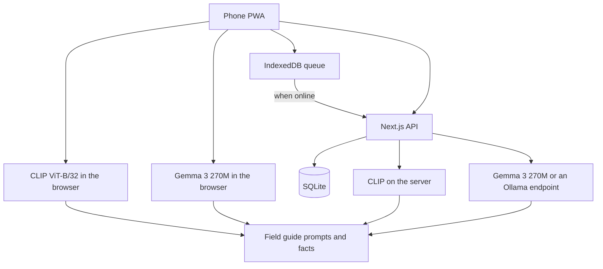

# Spotted

See nature. Share it. You photograph a bird, animal, insect, or plant. An open model suggests the name. Then you share the sighting, or you just look up again.

The product name is one constant, `APP_NAME` in [`src/config/brand.ts`](src/config/brand.ts).

The demo trail is fictional and West African: Lekki Conservation Centre, Okomu National Park, Obudu Mountain Resort, and Yankari Game Reserve. The guide also includes species from elsewhere, so a walk outside Nigeria still gets a name. Reference photos are credited in [`public/seed/credits.json`](public/seed/credits.json). The people in the feed are not real.

## Verify in 60 seconds

Live app: [https://spotted-91b2.onrender.com](https://spotted-91b2.onrender.com)

1. Open the field tab and run a reference photo (pied kingfisher is a clear one).
2. On the result, press **Look up**. The first time, Gemma 3 270M downloads in the browser. The screen then dims to a 60-second timer and one thing to notice.
3. When the minute ends, or when you press **I looked**, answer **What did you notice?** That line is saved into the sighting note.

You should see a common name when the match is clear, or a designed **Not in my guide yet** state with two or three maybes when it is not. The look-up line is labeled **Gemma 3 270M on this phone** or **Field guide** if this device cannot run the model.

## Built during the challenge

This was built for the [Hacktoberfest Open-Source AI Challenge, Week 1: Touch Grass](https://dev.to/challenges/hacktoberfest-week1-2026-10-05). An AI coding assistant helped with the implementation. The field guide facts are checked against published sources linked on each species, and the outdoor story in `docs/dev-post.md` is left for the person who actually took the walk. The demo people and their notes are fiction.

## Run it

Node 22 or newer.

```bash
npm ci
npm run dev
```

Open [http://127.0.0.1:4317](http://127.0.0.1:4317). The field tab can name a reference photo immediately if server models are on (the default in development). Choose **This phone** to run CLIP in the browser. The first phone run downloads the weights and then works offline.

```bash
npm test
npm run typecheck
npm run lint
npm run build
npm start
```

Copy [`.env.example`](.env.example) to `.env.local` if you want to change the defaults.

| Variable | Default | What it does |
| --- | --- | --- |
| `DEMO_MODE` | on | Seeds the fictional trail. `false` leaves only your empty profile. |
| `DATA_DIR` | `./data` | SQLite file and uploads. |
| `ENABLE_SERVER_MODELS` | on in development, off in production | Lets the API run CLIP and Gemma. Needs about 2 GB free. |
| `GEMMA_BASE_URL` | empty | Optional OpenAI-compatible endpoint, such as Ollama at `http://127.0.0.1:11434/v1`. |
| `GEMMA_MODEL` | `gemma3:270m` | Model name on that endpoint. |

## What you can do

- Land, then open a phone-shaped field guide.
- Take a photo, upload one, or try a reference image.
- Get a common name, scientific name, confidence, and the next-best names.
- If the top score is below 0.12, or the gap to second place is below 0.04, the screen says it is not sure and lets you save an unknown sighting under your own label.
- Read habitat, diet, behaviour, and conservation status without a network. Each species links a source.
- Press **Look up**. Gemma 3 270M runs in the browser and names one thing to notice for 60 seconds. If the phone cannot run it, the guide's behaviour line is used and labeled as such.
- Ask the server to rewrite the facts. If the rewrite does not name the species, the guide note stays.
- Post a sighting, comment, and react. A life list and a streak sit on the profile.
- See a map. Shared pins are opt-in. Sensitive species are stored as a cell about 11 km across. The server never receives the exact point.
- Save a note while offline. It syncs when the phone is back. The installed app caches its shell in production.

## Architecture



The guide is the allow-list. CLIP may only return a name from it. Scores are a softmax over the whole guide, so the unsure rule is a top score under 0.12 or a margin under 0.04 (`GUIDE_SCORE_FLOOR` and `GUIDE_MARGIN_FLOOR` in [`src/lib/identify/rank.ts`](src/lib/identify/rank.ts)). Gemma may only use the behaviour fact for Look up, and only the four stored facts for a trail note. A rewrite that fails the check is dropped.

Privacy sits in [`src/lib/privacy.ts`](src/lib/privacy.ts). Sharing is off unless the person opts in. Threatened species, and a few timber trees marked sensitive, are snapped to a 0.1 degree cell before insert.

## Why open-weight


| Piece | What | Where it runs | License |
| --- | --- | --- | --- |
| Names | CLIP ViT-B/32, `Xenova/clip-vit-base-patch32`, 8-bit | Browser (WASM) and optional server | MIT |
| Look up | Gemma 3 270M Instruct, `onnx-community/gemma-3-270m-it-ONNX`, `q4f16` on WebGPU, `q4` on WASM | Browser, cached after the first download. The graph in `public/models/gemma` adds one int32 cast so the WASM runtime can run the official weights. | [Gemma Terms of Use](https://ai.google.dev/gemma/terms) |
| Trail note | Same Gemma build, or Ollama `gemma3:270m` | Server, only if you turn models on | [Gemma Terms of Use](https://ai.google.dev/gemma/terms) |
| Swap-in, not bundled | BioCLIP, `imageomics/bioclip` | Not shipped. No Transformers.js ONNX build yet | MIT |
| Runtime | `@huggingface/transformers` | Browser and server | Apache-2.0 |

Open models are the reason this works on a walk.

- **No signal.** After the weights are cached, CLIP runs on the phone. A closed API would stop at the tree line.
- **The photo can stay put.** Naming does not require uploading the picture. If you do use your own server, a sensitive location is coarsened first.
- **No per-name bill.** A community trail should not meter curiosity.
- **Swappable.** The guide is a list of prompts. A larger Gemma, an Ollama process, or a future BioCLIP ONNX file replaces a file, not a vendor contract.

Gemma 3 270M is small enough to run and too small to trust with natural history. That is why the facts live in the repo. See [`THIRD_PARTY_NOTICES.md`](THIRD_PARTY_NOTICES.md).

## Deploy on Render

[Render](https://render.com) is a featured category for this challenge. The blueprint is [`render.yaml`](render.yaml).

1. Push this repository to GitHub or GitLab.
2. In the Render dashboard, choose **New** then **Blueprint**. Point it at the repo. Render reads `render.yaml`.
3. The blueprint creates a free web service in Frankfurt, builds with `npm ci --include=dev && npm run build`, and starts with `npm start`. `PORT` is provided by Render. The health check is `/api/health`. Dev dependencies stay installed because `NODE_ENV` is `production`.
4. Free instances have about 512 MB of RAM. `ENABLE_SERVER_MODELS` is `false` there, on purpose. The trail, the map, and the life list run. Naming runs in the visitor's browser.
5. Open the service URL. The demo trail is seeded the first time the database is created.

To run the models on Render as well:

1. Use an instance with at least 2 GB of RAM. Gemma on top of CLIP wants more headroom than CLIP alone.
2. Set `ENABLE_SERVER_MODELS` to `true` and redeploy.
3. The first identify request downloads CLIP into `DATA_DIR/models`. The first Gemma note downloads about 300 MB.

The free filesystem is ephemeral. Demo data returns when the SQLite file is gone, because an empty database is seeded again. Uploaded photos can disappear on a new instance. For a paid instance, add a disk mounted at `/var/data` and set `DATA_DIR=/var/data`.

Optional narrator, anywhere Node can see it:

```bash
ollama pull gemma3:270m
```

Set `GEMMA_BASE_URL=http://127.0.0.1:11434/v1` and `GEMMA_MODEL=gemma3:270m`. The API tries that endpoint before the in-process Gemma file.

Manual setup, if you are not using the blueprint: New Web Service, runtime Node, build command `npm ci --include=dev && npm run build`, start command `npm start`, health check path `/api/health`, and the env vars in `render.yaml`.

## Project shape

```
src/app/                 pages and API routes
src/components/          phone UI, map, identify flow
src/data/species.ts      the field guide, plus src/data/more-species.ts
src/lib/identify/        CLIP and Gemma
src/lib/privacy.ts       pins
src/lib/db.ts            SQLite
public/seed/             reference photos and credits
docs/dev-post.md         DEV challenge draft
docs/demo-script.md      shot list for a short video
```

Commits after the challenge deadline, if this is used as a submission, should be noted here. Hacktoberfest 2026 asks for that.

## License

MIT for the code. See [LICENSE](LICENSE). Model weights and photographs keep their own licenses.
